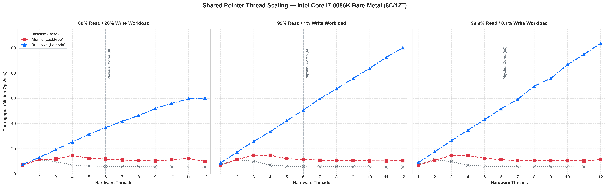
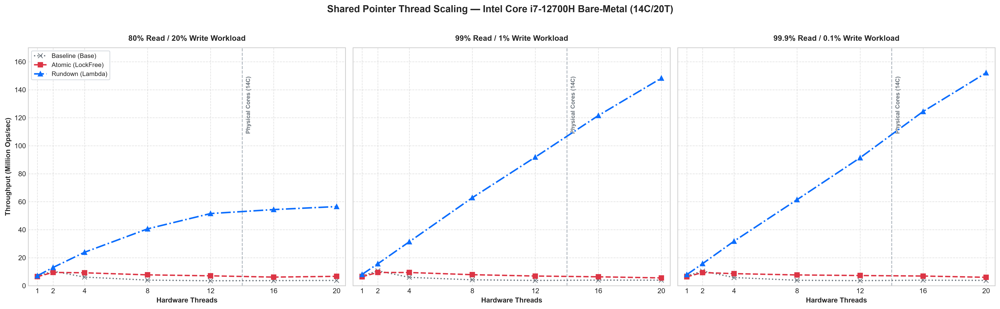
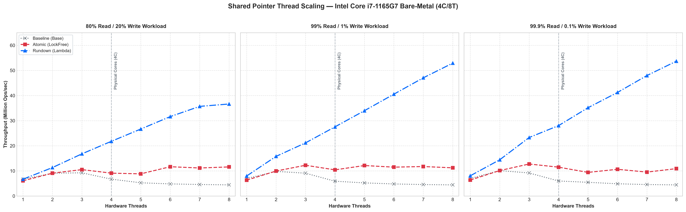
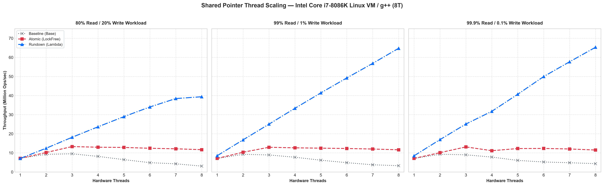

# LockFreeSharedPtr

**Cross-Platform Lock-Free Shared Pointers (`RundownSharedPtr`, `AtomicSharedPtr`)**


* **Header-only C++20 primitives:** `RundownSharedPtr` (epoch-based, **0** per-object read RMWs, `load_persistent()` promotion) and `AtomicSharedPtr` (128-bit split-count CAS for immediate reclamation and `compare_exchange_*`) targeting Windows, Linux, and macOS (x64 / ARM64).
* **User-controlled, bounded GC (`RundownSharedPtr`):** No hidden background threads; client-driven two-phase epoch reclamation with $O(1)$ epoch advance per batch, $\le 256$-slot drain checks, and Head-of-Line blocking protection.
* **NUMA- & cache-aware layout:** Single-allocation payload isolation (`64B` x64 / `128B` ARM64), lock-free per-slot recycling, and 64 KB node-local NUMA bump slabs (falling back to aligned heap allocation on UMA systems and macOS).
* **Observed read-dominant scaling ([benchmarks](#benchmarks--scaling-performance)):** Near-linear scaling on 99/1 and 99.9/0.1 batched-read sweeps (`BatchedRundownGuard`) across tested x64 systems—reaching **152.06 Mops/s** (**19.2x** vs. 1T) on i7-12700H (20T, Windows MSVC 2026), **103.64 Mops/s** (**11.8x**) on i7-8086K (12T, Windows MSVC 2026), and **65.30 Mops/s** (**7.7x**) on an 8-vCPU i7-8086K Linux VM (GCC 16).
* **Observed unbatched read latency ([benchmarks](#benchmarks--scaling-performance)):** **12–30 ns** P50 and **102–431 ns** P99.99 under continuous paced writes (75/25 read/write, ~3 µs updates) across the tested i7-8086K, i7-1165G7, and i7-12700H x64 systems (Windows MSVC 2026 & Linux GCC 16).
* **Verified under contention & oversubscription:** Zero memory leaks or use-after-free faults across live-allocation MPMC, chaos-yield, and 6x-oversubscription soaks (48–120 threads) on the tested Windows (MSVC 2026) and Linux (GCC 16 / Clang 22) x64 systems.

## Table of Contents
1. [Overview](#overview)
2. [Quick Start & API Overview](#quick-start--api-overview)
3. [Architecture & Algorithms](#architecture--algorithms)
   * [High-Level Design: Transient Access vs. Persistent Ownership](#high-level-design-transient-access-vs-persistent-ownership)
   * [User-Controlled Garbage Collection (`RundownSharedPtr`)](#user-controlled-garbage-collection-rundownsharedptr)
   * [1. Epoch-Based NUMA- & Cache-Aware Rundown (`rundown_shared_ptr.h`)](#1-epoch-based-numa---cache-aware-rundown-rundown_shared_ptrh)
   * [2. 128-Bit Split-Count Atomic Shared Pointer (`atomic_shared_ptr.h`)](#2-128-bit-split-count-atomic-shared-pointer-atomic_shared_ptrh)
   * [3. Single-Allocation Cache-Isolated Memory Layout](#3-single-allocation-cache-isolated-memory-layout)
4. [Benchmarks & Scaling Performance](#benchmarks--scaling-performance)
5. [Project Layout](#project-layout)
6. [Building Instructions](#building-instructions)
7. [Choosing the Right Shared Pointer](#choosing-the-right-shared-pointer)
8. [Conclusion](#conclusion)
9. [License](#license)

---

## Overview

High-throughput user-mode services—such as packet processors, routing engines, feature-flag stores, configuration managers, and in-memory caches—frequently maintain shared state that is read on every request path and replaced periodically in the background. Standard library `std::atomic<std::shared_ptr<T>>` is **not lock-free** on MSVC 2026, GCC 16 (libstdc++), or Clang 22 (`is_lock_free() == false`), serializing concurrent readers and writers behind internal lock tables and inducing multi-microsecond tail-latency spikes. Even custom lock-free reference-counted pointers force every reader to execute atomic read-modify-write instructions (`LOCK CMPXCHG16B` / `CASP` and `LOCK XADD` / `LDADD`) against shared anchor and control-block cache lines, causing MESI interconnect saturation and throughput plateaus beyond 3–4 threads.

`LockFreeSharedPtr` provides two header-only, cross-platform C++20 smart pointer architectures for Windows, Linux, and macOS (x64 and ARM64). Primary emphasis is placed on **`RundownSharedPtr<T>`** (`rundown_shared_ptr.h`), an **Epoch-Based, NUMA- & Cache-Aware Shared Pointer** that decouples short-lived transient reads from long-lived persistent ownership—demonstrating near-linear read-dominant multi-core scaling and sub-microsecond read tail latencies (`12–30 ns` P50; `102–431 ns` P99.99) across our tested Windows (MSVC 2026) and Linux (Fedora 44 / Ubuntu 26.04.1 LTS, GCC 16 & Clang 22) x64 systems, paired with amortized two-phase batch reclamation. For low-concurrency paths requiring immediate deterministic destruction or Compare-And-Swap (`compare_exchange_*`) state machines without deferred garbage collection, a **128-Bit Split-Reference-Counted** implementation **`AtomicSharedPtr<T>`** (`atomic_shared_ptr.h`) based on Anthony Williams' algorithm is also provided (lock-free when the target CPU, compiler flags, and runtime support hardware 128-bit atomics; checkable via `is_lock_free()`).

### Core Primitives Summary

| Primitive & Header | Reader Progress & Mechanism | Reader Atomic RMWs | Reclamation Model | Primary Use Case |
| :--- | :--- | :--- | :--- | :--- |
| **`RundownSharedPtr<T>`**<br>`rundown_shared_ptr.h` | **Lock-free** *(wait-free fast path when epoch is unchanged; strictly wait-free inside `BatchedRundownGuard<T>::read()`)*<br>Per-thread cache-isolated epoch slot (`rundown_refs[epoch & 1]`) | **0** per-object<br>*(x64: `1` private-slot `fetch_add` on entry, plain release store on exit; ARM64: `0` RMWs via relaxed store + `DMB ISH` & `STLR`; `0` inside batch guards)* | Client-driven deferred two-phase epoch GC pass + NUMA-affinitized control-block recycling | **Default choice:** High-throughput read-dominant & mixed multi-core/NUMA workloads, low read tail latency |
| **`AtomicSharedPtr<T>`**<br>`atomic_shared_ptr.h` | **Lock-free when hardware 128-bit atomics are enabled** *(target/compiler-dependent; verify via `is_lock_free()`)*<br>128-bit CAS loop on anchor + 64-bit wait-free packed `fetch_add` reconciliation | **2** on `load()`<br>**1** on handle destruction | Immediate deterministic free when internal and external counts reach zero | Low-concurrency paths requiring `compare_exchange`, `exchange`, or zero-GC immediate destruction |

---

## Quick Start & API Overview

### Detailed Usage Guides & API References

Full API specifications, memory-ordering guarantees, and production integration patterns (including event-driven GC worker threads, 32-read `BatchedRundownGuard` loops, NUMA per-node anchors, Copy-On-Write CAS loops, and custom fatal error handlers) are documented in separate files:

| Primitive | Header | Usage Guide & Design Patterns | API Reference |
| :--- | :--- | :--- | :--- |
| **Epoch-Based Cache-Aware Rundown** | `rundown_shared_ptr.h` | [Rundown Usage Guide](docs/rundown_shared_ptr_usage.md) | [Rundown API Reference](docs/rundown_shared_ptr_api.md) |
| **128-Bit Split-Count Atomic** | `atomic_shared_ptr.h` | [Atomic Usage Guide](docs/atomic_shared_ptr_usage.md) | [Atomic API Reference](docs/atomic_shared_ptr_api.md) |

---

### Core API Summary

#### Epoch-Based Rundown Pointer (`rundown_shared_ptr.h`)

| Component / Operation | Primitive / Method | Progress Guarantee | Description |
| :--- | :--- | :--- | :--- |
| **Shared Anchor** | `RundownSharedPtr<T>` | Cache-line isolated | Thread-safe publication anchor (`alignas(CACHE_LINE_SIZE)`). |
| **Persistent Handle** | `PersistentSharedPtr<T>` | Wait-free copy/move/deref & non-final dtor *(final free recycles/deletes)* | Reference-counted handle keeping `T` alive outside `read()` scopes. |
| **Batched Guard** | `BatchedRundownGuard<T>` | **Wait-free** (`0` atomics/read) | Stack-scoped RAII guard pinning an epoch slot across burst reads. |
| **Single-Alloc Factory** | `MakeRundownShared<T>(...)`<br>`MakeRundownSharedNuma<T>(...)` | Lock-free on slot hit *(spin-locked on spare stack / NUMA slab refill; OS heap on UMA miss)* | Allocates control block and cache-isolated payload `T` in one block. |
| **Transient Read** | `anchor.read(lambda)`<br>`anchor.acquire_batched()` | **Lock-free** *(wait-free fast path when epoch is unchanged; `0` per-object RMWs)* | Execute-around lambda access or batched read guard under epoch protection. |
| **Persistent Checkout** | `anchor.load_persistent()` | **Lock-free** *(wait-free fast path when epoch is unchanged)* | Promotes active object to `PersistentSharedPtr<T>` and releases epoch slot. |
| **Pointer Replacement** | `anchor.store(desired)` | **Lock-free** *(assuming non-blocking `wake_callback`)* | Atomically swaps active pointer and pushes displaced block to NUMA SList. |
| **GC Singleton** | `SharedPtrGarbageCollector` | Nonblocking reader eligibility (`is_flush=false`); blocking spin-wait (`is_flush=true`) | Process-wide singleton: `get_instance()`, `set_wake_callback()`, `process_garbage_pipeline()`. |
| **Fatal Error Hook** | `SetRundownPtrErrorHandler()` | **Wait-free** | Installs custom `noexcept` callback invoked before `std::abort()`. |

#### Immediate-Reclamation Split-Count Pointer (`atomic_shared_ptr.h`)

| Component / Operation | Primitive / Method | Progress Guarantee | Description |
| :--- | :--- | :--- | :--- |
| **Shared Anchor** | `AtomicSharedPtr<T>` | Cache-line isolated | 128-bit CAS anchor (`alignas(CACHE_LINE_SIZE)`); check `is_lock_free()`. |
| **Local Handle** | `LocalSharedPtr<T>` | **Wait-free** copy/move/deref & non-final dtor *(heap free on final dtor)* | Thread-local reference-counted handle caching direct `T*` (`->`, `*`, `get()`, `use_count()`). |
| **Single-Alloc Factory** | `MakeLocalShared<T>(...)` | OS heap-allocated | Allocates `ControlBlock<T>` and cache-aligned payload `T` in one block. |
| **Checkout / Replace** | `load()` / `store()` / `exchange()` | **Lock-free** when 128-bit atomics are lock-free *(verify via `is_lock_free()`; final free uses OS heap)* | 128-bit CAS handle checkout, unconditional replacement, and swap-and-extract. |
| **Conditional CAS** | `compare_exchange_strong()`<br>`compare_exchange_weak()` | **Lock-free** when 128-bit atomics are lock-free *(verify via `is_lock_free()`; final free uses OS heap)* | Lvalue & rvalue 128-bit CAS with spurious-failure immunity on `strong`. |
| **Fatal Error Hook** | `SetAtomicPtrErrorHandler()` | **Wait-free** | Installs custom `noexcept` callback invoked before `std::abort()`. |

---

### Quick Start: High-Throughput Epoch Rundown (`RundownSharedPtr`)

```cpp
#include <cstdint>
#include <utility>
#include "rundown_shared_ptr.h"

struct NetworkConfig
{
    uint32_t max_connections;
    uint32_t timeout_ms;
    bool     jumbo_frames;

    NetworkConfig(uint32_t max_conn,
                  uint32_t timeout,
                  bool     jumbo) noexcept : max_connections(max_conn),
                                             timeout_ms(timeout),
                                             jumbo_frames(jumbo)
    {
    }
};

// Shared cache-aligned publication anchor
RundownSharedPtr<NetworkConfig> g_NetConfig;

// ----------------------------------------------------------------------------
// 1. Lock-Free Fast-Path Reader (0 Per-Object Atomic RMWs)
// ----------------------------------------------------------------------------
bool ShouldAcceptConnection(uint32_t active_connections) noexcept
{
    return g_NetConfig.read([active_connections](const NetworkConfig* cfg) noexcept -> bool
    {
        return cfg && (active_connections < cfg->max_connections);
    });
}

// ----------------------------------------------------------------------------
// 2. Persistent Promotion (Safe for Blocking I/O or Async Tasks)
// ----------------------------------------------------------------------------
PersistentSharedPtr<NetworkConfig> CaptureConfigSnapshot() noexcept
{
    // Increments persistent_ref_count under transient epoch protection,
    // immediately releases the epoch slot, and returns an independent handle.
    return g_NetConfig.load_persistent();
}

// ----------------------------------------------------------------------------
// 3. Writer Update (Allocation via Factory + Lock-Free Anchor Publication)
// ----------------------------------------------------------------------------
bool UpdateNetworkConfig(uint32_t new_max_conn,
                         uint32_t new_timeout_ms,
                         bool     new_jumbo)
{
    // Allocation hits the lock-free per-slot cache in the common case, and may
    // take internal refill spinlocks or invoke the OS allocator on cache misses.
    PersistentSharedPtr<NetworkConfig> new_cfg = MakeRundownShared<NetworkConfig>(new_max_conn,
                                                                                  new_timeout_ms,
                                                                                  new_jumbo);
    if (!new_cfg)
    {
        return false;
    }

    // Publication itself is lock-free (assuming any registered wake_callback is non-blocking):
    // atomically swaps active_control_block and stages the displaced block to the NUMA SList.
    return g_NetConfig.store(std::move(new_cfg));
}

// ----------------------------------------------------------------------------
// 4. Garbage Collection Maintenance (Called Periodically or via Wake Callback)
// ----------------------------------------------------------------------------
void OnMaintenanceTick() noexcept
{
    // is_flush = false: nonblocking reader eligibility check + two-phase batch reclamation
    SharedPtrGarbageCollector::get_instance().process_garbage_pipeline(false);
}
```

### Quick Start: Immediate Reclamation & CAS State Machines (`AtomicSharedPtr`)

When deferred garbage collection is not desired—or when concurrent writers must perform Copy-On-Write (`compare_exchange_strong`) transitions—use `AtomicSharedPtr<T>` and `LocalSharedPtr<T>`:

```cpp
#include <cassert>
#include <cstdint>
#include <utility>
#include "atomic_shared_ptr.h"

// Uses struct NetworkConfig defined above
AtomicSharedPtr<NetworkConfig> g_AtomicConfig;

// Optional startup check confirming hardware 128-bit lock-free support on this build/target:
// assert(g_AtomicConfig.is_lock_free());

// ----------------------------------------------------------------------------
// 1. Reader Checkout (Zero-Indirection Dereference)
// ----------------------------------------------------------------------------
bool ShouldAcceptConnectionAtomic(uint32_t active_connections) noexcept
{
    LocalSharedPtr<NetworkConfig> cfg = g_AtomicConfig.load();
    return cfg && (active_connections < cfg->max_connections);
} // 'cfg' drops out of scope; object is freed immediately if this was the final reference

// ----------------------------------------------------------------------------
// 2. Copy-On-Write Update via compare_exchange_strong
// ----------------------------------------------------------------------------
void IncreaseConnectionLimit(uint32_t delta)
{
    LocalSharedPtr<NetworkConfig> expected = g_AtomicConfig.load();

    while (true)
    {
        const uint32_t next_max     = expected ? (expected->max_connections + delta) : delta;
        const uint32_t next_timeout = expected ? expected->timeout_ms : 500u;
        const bool     next_jumbo   = expected ? expected->jumbo_frames : false;

        LocalSharedPtr<NetworkConfig> desired = MakeLocalShared<NetworkConfig>(next_max,
                                                                               next_timeout,
                                                                               next_jumbo);

        // Retries internally on benign reader external_count updates; returns false
        // only when another writer replaced the anchor (updating 'expected' automatically).
        if (g_AtomicConfig.compare_exchange_strong(expected, std::move(desired)))
        {
            break;
        }
    }
}
```

---

## Architecture & Algorithms

### High-Level Design: Transient Access vs. Persistent Ownership

In most concurrent user-mode applications, reads to shared configuration, routing, or state structures are brief inspections: a worker reads several fields, executes a routing or policy decision, and returns. Reference-counted smart pointers force every short-lived reader to pay the same cross-core cache-coherency penalty as a long-lived owner.

`RundownSharedPtr` resolves this by separating access into two distinct paths:
* **Transient Read Path (`read` / `acquire_batched`):** Binds read access to a lexical scope via an execute-around lambda (`anchor.read([](const T* obj) { ... })`) or a stack-bound `BatchedRundownGuard<T>`. Protection is acquired on the calling thread's dedicated cache-isolated epoch slot rather than on the target object. The reader performs an acquire load of `active_control_block`, computes `T*` via compile-time constant byte-offset arithmetic (`get_payload()`), and invokes the callback without ever touching the control block's mutable cache line.
* **Persistent Ownership Path (`load_persistent`):** When an object must outlive the immediate scope (e.g., passed to an asynchronous thread pool, held across blocking network/disk I/O, or stored in a session context), `load_persistent()` acquires transient epoch protection via `acquire_batched()`, atomically increments `persistent_ref_count`, releases the transient epoch slot before returning, and hands back a `PersistentSharedPtr<T>`.

### User-Controlled Garbage Collection (`RundownSharedPtr`)

Writer publication (`store()`) is lock-free (assuming a non-blocking `wake_callback`): it transitions `anchor_state` (using a relaxed store fast path when the caller holds the sole reference `persistent_ref_count == 1`), atomically exchanges `active_control_block`, and pushes any displaced block onto the calling processor's NUMA-local lock-free SList shard. Reclaiming those displaced objects requires waiting until readers registered on the outgoing epoch shard have exited.

Rather than spawning hidden background threads with unpredictable scheduling behavior, `SharedPtrGarbageCollector` operates as a **process-wide singleton** driven explicitly by the client application through one of two models:
* **Event-Driven Wake Callback (`set_wake_callback`):** Registers a lightweight notification callback triggered once per accumulation cycle when `queue_depth` crosses `high_watermark`. **The callback executes on the writer thread inside `store()`**, so it should only signal a condition variable or atomic flag to wake a background GC thread (never call `process_garbage_pipeline(true)` synchronously from inside a `read()` scope).
* **Periodic Maintenance (`process_garbage_pipeline`):** Applications with existing maintenance loops or infrequent updates can invoke `process_garbage_pipeline(false)` on a timer without registering a wake callback.

---

### 1. Epoch-Based NUMA- & Cache-Aware Rundown (`rundown_shared_ptr.h`)

`RundownSharedPtr` combines Epoch-Based Reclamation (EBR) with decoupled per-thread single-writer reader slots, lock-free NUMA SList staging, and node-affinitized control-block recycling.

#### Algorithmic Approach: Alternating Inline Epoch Shards & Decoupled Slot Counters
`SharedPtrGarbageCollector` maintains two inline epoch shards (`rundown_refs[0]` and `rundown_refs[1]`), each containing `SHAREDPTR_READER_SLOTS` (`256`) cache-line-padded `RundownRef` slots. Each `RundownRef` slot holds **both** a single-writer `active_readers` counter and a multi-writer `shared_readers` counter:
1. **Collision-Free Per-Thread Slot Assignment:** On first touch, each thread lazily acquires an exclusive slot ID (`0..255`) from `allocated_slot_mask` via a lock-free CAS loop inside a `thread_local ThreadSlotOwner` RAII helper and caches the raw token in a constant-initialized `thread_local uint32_t` (compiling to a direct TLS load on the hot path). If more than `256` threads are concurrently active, overflow threads increment `overflow_slot_refs`, hash across slots `0..255`, and are tagged with `SLOT_SHARED_FLAG`; late `thread_local` destructors running after `~ThreadSlotOwner()` are redirected to slot `0` with `SLOT_SHARED_FLAG`.
2. **Lock-Free Reader Entry & Non-RMW Exit:**
   * Primary slot owners mutate their slot's `active_readers` exclusively: entry enforces Store-Load Dekker ordering (`fetch_add(1, seq_cst)` on x64; relaxed increment + `DMB ISH` fence on ARM64, elided on nested reads), validates `active_epoch == epoch` with `memory_order_seq_cst` (retrying only if the GC advanced `active_epoch` mid-entry), and loads `active_control_block` with `memory_order_acquire`.
   * On scope exit, primary slot owners decrement `active_readers` using a **plain single-writer non-RMW release store** (`MOV` on x64, `STLR` on ARM64)—eliminating the second `LOCK`-prefixed RMW and store-buffer drain.
   * Oversubscribed threads ($>256$) and late TLS destructors route through their assigned slot's separate `shared_readers` atomic counter (`fetch_add` / `fetch_sub`) so they never race with a primary owner's non-RMW release store.
   * Once acquired, `BatchedRundownGuard<T>::read()` executes **strictly wait-free** with zero atomic operations or loops.
3. **Nonblocking Reader Eligibility and Two-Phase Batch Reclamation (`process_garbage_pipeline`):**
   * **Phase A — Eligibility Check ($`O(\text{active\_slots})`$, $\le 256$) & Batch Destruction ($O(M)$):** If `pending_free_lists` holds batches from a prior epoch swap, the collector determines `max_slots = get_active_slot_bound()`—which automatically expands to all `256` slots whenever `overflow_slot_refs > 0` (and always includes slot `0` for late TLS destructors since `max_allocated_slot >= 1`). On every scanned slot in `rundown_refs[pending_epoch & 1]`, `try_reinitialize()` verifies `(active_readers.load(acquire) | shared_readers.load(acquire)) == 0`, so reclamation proceeds **only when both exclusive primary readers and shared overflow/late-TLS readers on the pending epoch have reached quiescence**. If any reader remains active during a non-flush run (`is_flush == false`), the collector exits immediately without waiting (**Head-of-Line Blocking Protection**) and retries on the next cycle (`is_flush == true` spins until drained). Once drained, it destroys and recycles all $M$ staged objects in $O(M)$ time ($O(1)$ amortized per object).
     > **Operational Note on Stalled Readers:** While an active reader remains in the outgoing epoch, reclamation of `pending_free_lists` is deferred and `active_epoch` does not advance again—allowing newly displaced objects to accumulate in the staging SLists until that reader exits. Keep transient `read()` and `BatchedRundownGuard<T>` scopes short, bounded, and non-blocking (refreshing batched guards periodically in long loops), and call `load_persistent()` before any sleep, blocking I/O, or extended retention.
   * **Phase B — Shard Detachment ($O(\text{nodes})$, $\le 64$) & Epoch Advance ($O(1)$):** Atomically detaches the fallback SList and all per-NUMA-node SLists into a compact `pending_free_lists` array in $O(\text{nodes})$ time without pointer chasing, resets `queue_depth` and `wake_requested`, advances the 64-bit `active_epoch` once ($O(1)$ per batch) with `memory_order_seq_cst` followed by a full `std::atomic_thread_fence(std::memory_order_seq_cst)` (required on ARMv8.3+ RCPC), and loops back once—including a brief 8-pause `HARDWARE_PAUSE()` grace check—to immediately reclaim the batch if in-flight nanosecond-scale readers have already drained.
   * **Deferred Wake Coalescing:** `is_gc_active` uses a 3-state machine (`0 = Idle`, `1 = Active`, `2 = Active + Deferred Wake`) so a high-watermark callback arriving while a pass is already in flight is never dropped.

#### Control-Block Recycling & 64 KB NUMA Bump Slabs
To avoid OS heap lock contention (`malloc`/`free`) under heavy write churn, destroyed control blocks are overlaid with an intrusive `FreeBlockNode` header and recycled through a three-tier hierarchy:
1. **Per-Slot Lock-Free Cache (`SlotBlockCache`):** Exclusive writer slots maintain an `active_batch` and `spare_batch` (bounded to `32` homogeneous blocks per batch) plus `writer_node` on the same cache line.
2. **Per-Node Multi-Batch Spare Stack (`SpareBatchStack`):** Completed 32-block batches (or batches evicted by heterogeneous payload sizes / foreign-node frees) are routed to active writer slots on the same NUMA node or pushed onto that node's spin-locked `SpareBatchStack` (up to `64` batches / `2,048` blocks, preserving heterogeneous payload sizes without destructive eviction, with lock-free relaxed empty/full pre-checks).
3. **64 KB Reference-Counted NUMA Bump Slab (`NumaSlabHeader`):** On multi-socket NUMA systems, cache misses carve up to `16` blocks at once (amortizing `slab_lock` and `active_blocks` atomic updates by 16x) from a node-local 64 KB slab allocated via `NumaAllocator::Allocate`, releasing `slab_lock` before invoking OS virtual-memory syscalls. Oversized payloads ($> 32\text{ KB}$) receive a dedicated single-block NUMA slab so they never evict a partially filled 64 KB arena. Single-node UMA systems and macOS bypass virtual slabs entirely and fall back directly to cache-aligned `::operator new`.

---

### 2. 128-Bit Split-Count Atomic Shared Pointer (`atomic_shared_ptr.h`)

For workloads requiring standard handle value semantics, immediate deterministic destruction without a garbage collector, or conditional Compare-And-Swap (`compare_exchange_weak` / `compare_exchange_strong`) and `exchange` operations, `atomic_shared_ptr.h` implements Anthony Williams' differential split-reference-counting algorithm.

#### Algorithmic Approach: Differential Split Reference Counting
Loading a control block address from a shared anchor and incrementing its reference count are two distinct memory operations; a concurrent writer can displace and free the control block between them. `AtomicSharedPtr<T>` closes this window without external locks, hazard pointers, or epochs:
1. **128-Bit External Count Anchor (`CountedPtr<T>`):** Packs `ControlBlock<T>* cb`, a 32-bit `external_count`, and a 32-bit ABA-prevention `generation` counter into a 16-byte aligned struct updated via 128-bit CAS.
   * **Target & Compiler Lock-Freedom Dependency:** On MSVC x64 (`_MSC_VER && !_M_ARM64`), `AtomicSharedPtr` invokes `_InterlockedCompareExchange128` (`CMPXCHG16B`) directly. On MSVC ARM64 and GCC/Clang (x64 & ARM64), it uses `std::atomic<CountedPtr<T>>`, which is lock-free only when the target ISA, compiler flags (such as `-mcx16` on x64 or ARMv8.1+ LSE / ARMv8.4+ LSE2 on ARM64), and `libatomic` provide hardware 128-bit atomics; otherwise `std::atomic<CountedPtr<T>>` may fall back to an internal `libatomic` lock table. Call **`anchor.is_lock_free()`** at runtime to verify whether your build and target execute lock-free.
2. **64-Bit Packed Split Control Block (`SplitCounts`):** Packs `int32_t internal` (bits `[31:0]`) and `int32_t external` (bits `[63:32]`) into a single `std::atomic<uint64_t>`. `apply_counts()` applies both signed deltas in a single wait-free 64-bit `fetch_add` using two's-complement borrow/carry compensation across bit 32, destroying the control block when both balances reach zero.
3. **Threshold-Triggered External Count Flushing (`EXT_COUNT_FLUSH_THRESHOLD`):** Under sustained read-only load (or when a single `ControlBlock<T>` is shared across multiple `AtomicSharedPtr<T>` anchors), if an anchor's `external_count` reaches `1 << 20` (`1,048,576`), the reader executes a 128-bit CAS retry loop while holding its pinned internal reference to reset `external_count` to `0` (bumping `generation`) and flush the accumulated balance into `cb->counts.external`.
4. **Spurious-Failure-Immune `compare_exchange_strong`:** Hoists the lvalue `desired` internal reference increment outside the CAS loop (avoiding redundant atomic RMWs), supports move-only-on-success rvalue `desired` overloads, and retries immediately without backoff when a concurrent reader mutates `external_count` while `current.cb == expected.cb`.

---

### 3. Single-Allocation Cache-Isolated Memory Layout

Both `MakeRundownShared` / `MakeRundownSharedNuma` and `MakeLocalShared` allocate the control block and payload object `T` inside a single cache-line-aligned allocation (`CACHE_LINE_SIZE`: 64 bytes on x64 including Intel macOS, 128 bytes on ARM64 / Apple Silicon), isolating mutable synchronization counters from read-mostly payload fields across cache-line boundaries.

#### Layout A: Epoch Rundown (`RundownControlBlock<T>`)
`MakeRundownShared` / `MakeRundownSharedNuma` place `RundownControlBlock<T>` at offset `0` and construct `T` via placement `new` at the compile-time constant `get_payload_offset()`. Fast-path readers resolve `T*` via `std::launder(reinterpret_cast<T*>(reinterpret_cast<unsigned char*>(this) + get_payload_offset()))` without loading the control block's cache line.

```text
+-----------------------------------------------------------------------+
| Cache Line 0 (Offset 0..63 x64 / 0..127 ARM64): RundownControlBlock   |
|   - RetiredBlock* next                  (8 bytes, lock-free SList)    |
|   - void (*delete_callback)(...)        (8 bytes, type-erased dtor)   |
|   - NumaSlabHeader* slab_owner          (8 bytes, owning 64 KB slab)  |
|   - std::atomic<int32_t> anchor_state   (4 bytes, 0=Free 1=Anchored)  |
|   - uint32_t numa_node                  (4 bytes, origin NUMA node)   |
|   - std::atomic<int32_t> persistent_ref_count (4 bytes)               |
|   - [Tail Padding to max(CACHE_LINE_SIZE, alignof(T)) Boundary]       |
+-----------------------------------------------------------------------+
| Cache Line 1+ (Offset 64+ x64 / 128+ ARM64): Embedded Payload (T)     |
|   - Constructed in-place via placement new at get_payload_offset()    |
|   - Isolated on separate cache line(s) from control-block metadata    |
+-----------------------------------------------------------------------+
```

#### Layout B: Deterministic Split-Count (`ControlBlock<T>`)
`MakeLocalShared` places `ControlBlock<T>` at offset `0` and constructs `T` at `payload_offset` (`(sizeof(ControlBlock<T>) + alloc_align - 1) & ~(alloc_align - 1)`), caching the direct `T*` pointer inside `LocalSharedPtr<T>` for zero-indirection dereferencing.

```text
+-----------------------------------------------------------------------+
| Cache Line 0 (Offset 0..63 x64 / 0..127 ARM64): ControlBlock<T>       |
|   - T* ptr                              (8 bytes, payload pointer)    |
|   - std::atomic<uint64_t> counts        (8 bytes: Internal & External)|
|   - bool is_embedded                    (1 byte)                      |
|   - [Tail Padding to max(CACHE_LINE_SIZE, alignof(T)) Boundary]       |
+-----------------------------------------------------------------------+
| Cache Line 1+ (Offset 64+ x64 / 128+ ARM64): Embedded Payload (T)     |
|   - Constructed in-place via placement new at payload_offset          |
|   - Isolated on separate cache line(s) from control-block metadata    |
+-----------------------------------------------------------------------+
```

---

## Benchmarks & Scaling Performance

User-mode synchronization primitives must be evaluated against hardware cache-coherency traffic, hybrid P-Core/E-Core scheduling, OS scheduler preemption, and multi-compiler codegen. The included cross-platform benchmark suite (`test_shared_ptr.cpp` / `test_shared_ptr.h`) was verified across **Windows (MSVC 2026)** and **Linux (Fedora 44 and Ubuntu 26.04.1 LTS using GCC 16 and Clang 22)**. All throughput and latency measurements below reflect results observed on those specific test systems and workloads; absolute figures will vary across CPU microarchitectures, memory topologies, compilers, and payload sizes.

---

### Test Methodology & Benchmark Architecture

The suite executes **21 sequential phases** evaluating three user-mode shared-pointer architectures across a common set of workload scenarios. Where appropriate, each implementation uses its intended operational strategy; scenario-specific operation-counting rules and execution paths are documented below:
* **Baseline (`std::atomic<std::shared_ptr<TrackedObject>>`):** The C++20 standard library atomic smart pointer (`is_lock_free() == false` across all tested MSVC 2026, GCC 16, and Clang 22 toolchains).
* **Atomic (`AtomicSharedPtr<TrackedObject>`):** The 128-bit interlocked split-reference-counting implementation (`atomic_shared_ptr.h`).
* **Rundown (`RundownSharedPtr<TrackedObject>`):** The epoch-based, NUMA- and cache-aware rundown implementation (`rundown_shared_ptr.h`).

#### What `Mops/s` Measures (Operation Counting Rules)
In all throughput phases, **`Mops/s`** reports aggregate `(completed read ops + completed write ops)` summed across all worker threads divided by the elapsed wall-clock measurement window (in millions of operations per second). The exact definition of one counted operation differs between the **unbatched soak phases** and the **thread scaling sweep**:

* **Unbatched Soak Phases (MPMC Soak, 6x Oversubscription, Concurrent Replacement, Heavy Exchange Contention, Hyper-Aggressive Chaos):**
  * **1 Reader Op:** One **unbatched** `shared->read(...)` (Rundown) or `shared->load()` (Baseline/Atomic) call. `RundownSharedPtr` does **not** use `BatchedRundownGuard` in these phases—every counted read acquires and validates an epoch slot, reads `obj->data`, and releases the slot. In Concurrent Replacement, the entire 25-step accumulation loop inside one `read()` / `load()` counts as **1 operation**.
  * **1 Writer Op:** One live payload allocation (`std::make_shared` / `MakeLocalShared` / `MakeRundownShared`) followed by one `shared->store(...)` (or alternating `store()` / `exchange()` for Baseline/Atomic during 6x Oversubscription and Concurrent Replacement; 100% `exchange()` during Heavy Exchange Contention).
* **Thread Scaling Sweep (80/20, 99/1, 99.9/0.1):**
  * **1 Reader Op:** One **logical payload inspection** (`obj->data`) plus the ~100 ns `BurnCycles(holdCycles)` hold:
    * *Baseline & Atomic (`ScalingWorker`):* One `shared->load()` checkout, volatile read, ~100 ns hold, and handle destruction.
    * *Rundown (`RundownScalingWorker`):* One call to **`BatchedRundownGuard<T>::read()`** plus the ~100 ns hold, with `acquire_batched()` amortizing epoch entry/exit over chunks of up to **32 consecutive reads** (`RUNDOWN_BATCH_CHECKPOINT = 32` — i.e., 4 reads per guard acquisition on 80/20, and up to 32 reads per guard acquisition on 99/1 and 99.9/0.1).
  * **1 Writer Op:** One `shared->store(...)` plus the ~100 ns `BurnCycles(holdCycles)` hold:
    * *Baseline & Atomic:* Copies a pre-allocated handle from a 4-element thread-local ring (`shared->store(preallocated[writeIdx])`, 0 heap allocations).
    * *Rundown:* Moves `preallocated[writeIdx]` into `shared->store(...)` and refills the slot via `MakeRundownShared<TrackedObject>(...)` (live control-block recycling/allocation on every write).

#### Additional Benchmark Controls
* **Sharded Instance Tracking (`ShardedInstanceCounter`):** `TrackedObject` updates a 64-shard cache-isolated global counter so test-harness leak verification does not introduce artificial cross-core cache-line bouncing between writers and the background GC thread.
* **Background GC Worker Configuration:** Runs a dedicated `GCWorkerThread` configured with a `65,535`-entry high-watermark callback and a 2-second periodic timeout, with periodic ticks suppressed (`g_PausePeriodicGc`) during scaling steps so deterministic inter-step synchronous flushes isolate per-step throughput.
* **Tail-Latency Capture:** Reader threads record individual **unbatched** `read()` / `load()` cycle deltas into 1,048,576-entry power-of-two ring buffers (`__rdtsc` on x64, `CNTVCT` / monotonic raw clock on ARM64) over 10-second intervals while writers pace updates every ~3 microseconds.
* **Zero-Leak Enforcement:** Every phase and every scaling step asserts `g_ActiveInstances.load() == 0` before and after execution.

---

### Multi-Core Scaling Analysis: Why `RundownSharedPtr` Dominates Multi-Core Workloads

Across our four tested x64 systems, lock-based `std::atomic<std::shared_ptr>` and per-checkout 128-bit CAS reference counting (`AtomicSharedPtr`) hit hard scalability ceilings beyond 2–4 threads. By contrast, `RundownSharedPtr` scaled **near-linearly across physical and SMT/hybrid cores on read-dominant workloads (99/1 and 99.9/0.1)** and achieved **5.5x–8.0x** scaling under write-heavy **80/20** contention (where 20% concurrent writes naturally begin contending on the shared anchor `exchange()` and staging stack at high thread counts).

> **Multi-Core Throughput Scaling (80/20, 99/1, and 99.9/0.1 Read/Write Ratios)** — Scaling comparison across Baseline (`std::atomic<std::shared_ptr>`), `AtomicSharedPtr` (128-bit CAS), and `RundownSharedPtr` (Epoch + 32-read `BatchedRundownGuard`).

<p>
  
  <br><em>Figure 1: Bare-Metal Desktop (Intel Core i7-8086K @ 4.00GHz — 6 Cores / 12 Threads, Windows MSVC 2026)</em>
</p>

**`Intel Core i7-8086K Bare-Metal (6C/12T)`:** On read-dominant workloads (**99/1** and **99.9/0.1**), `RundownSharedPtr` scaled near-linearly past the 6-core physical boundary (`6C`) to **100.07 Mops/s** (99/1, 11.6x) and **103.64 Mops/s** (99.9/0.1, 11.8x) at 12 logical threads. Under heavy **80/20** write contention, it scaled sub-linearly past 6C to **60.33 Mops/s** (7.9x). In contrast, `AtomicSharedPtr` peaked at 3–4 threads (~14.6–14.8 Mops/s) and flattened near **9.9–11.3 Mops/s** at 12 threads due to 128-bit CAS cache-line invalidations, while `std::atomic<std::shared_ptr>` peaked at 2 threads (~11.2 Mops/s) before regressing to **5.33–5.35 Mops/s**.

---

<p>
  
  <br><em>Figure 2: Bare-Metal Hybrid Laptop (12th Gen Intel Core i7-12700H — 14 Cores [6P + 8E] / 20 Threads, Windows MSVC 2026)</em>
</p>

**`Intel Core i7-12700H Bare-Metal (14C/20T)`:** On hybrid P-Core/E-Core silicon, `RundownSharedPtr` scaled near-linearly on read-dominant workloads across all 14 physical cores (`14C`) and 20 logical threads to **148.26 Mops/s** (99/1, 18.3x) and **152.06 Mops/s** (99.9/0.1, 19.2x)—outperforming `AtomicSharedPtr` by **25.3x** and `std::atomic<std::shared_ptr>` by **40.0x** on this system. Under **80/20** write load, `RundownSharedPtr` climbed strongly to **51.56 Mops/s** at 12 threads and leveled off sub-linearly to **56.54 Mops/s** (8.0x) at 20 threads as 20% concurrent writes saturated the single anchor's `exchange()` cache line. Meanwhile, cross-cluster coherency latency caused `AtomicSharedPtr` to peak at 2 threads (~9.4–9.5 Mops/s) and decline to **5.58–6.70 Mops/s** at 20 threads, while `std::atomic<std::shared_ptr>` collapsed from ~10.5 Mops/s (2T) down to **3.77–3.97 Mops/s**.

---

<p>
  
  <br><em>Figure 3: Bare-Metal Ultrabook (11th Gen Intel Core i7-1165G7 @ 2.80GHz — 4 Cores / 8 Threads, Windows MSVC 2026)</em>
</p>

**`Intel Core i7-1165G7 Bare-Metal (4C/8T)`:** On 4-core/8-thread Tiger Lake silicon, `RundownSharedPtr` scaled near-linearly through the 4-core physical boundary (`4C`) on read-dominant workloads to **52.91 Mops/s** (99/1, 6.6x) and **53.68 Mops/s** (99.9/0.1, 6.7x) at 8 threads, while reaching **36.64 Mops/s** (5.5x) under **80/20** write load. `AtomicSharedPtr` plateaued near **10.9–11.6 Mops/s** beyond 3 threads, and `std::atomic<std::shared_ptr>` peaked at 2–3 threads (~9.2–10.1 Mops/s) before regressing to **4.43–4.44 Mops/s**.

---

<p>
  
  <br><em>Figure 4: Linux Virtualized Guest / GCC 16 (Intel Core i7-8086K @ 4.00GHz — 8 vCPUs, Linux <code>g++</code>)</em>
</p>

**`Intel Core i7-8086K Linux VM / GCC 16 (8T)`:** Under Linux `g++` (GCC 16) and virtualized SMP scheduling, `RundownSharedPtr` scaled near-linearly on read-dominant workloads from ~8.5 Mops/s on 1 vCPU to **64.76 Mops/s** (99/1, 7.6x) and **65.30 Mops/s** (99.9/0.1, 7.7x) at 8 vCPUs, and reached **39.40 Mops/s** (5.6x) on **80/20**. `AtomicSharedPtr` peaked at 3 vCPUs (~12.9–13.3 Mops/s) and plateaued around **11.5–11.7 Mops/s**, while libstdc++'s `std::atomic<std::shared_ptr>` peaked at 2–3 vCPUs (~9.2–9.5 Mops/s) and fell to **3.08–4.36 Mops/s** at 8 vCPUs. *(Raw Linux Clang 22 telemetry on the same 8-vCPU i7-8086K guest is available in [`perf_data/shared_ptr_clang++.txt`](perf_data/shared_ptr_clang++.txt).)*

---

#### Why `std::atomic<std::shared_ptr>` and `AtomicSharedPtr` Plateau
1. **Standard Library Lock Contention (`std::atomic<std::shared_ptr>`):** Because `is_lock_free()` is `false`, concurrent loads serialize behind an internal mutex/spinlock table. Across our tested systems, throughput peaked at 2–3 threads (~9.2–11.2 Mops/s) and degraded under contention to **3.08–5.35 Mops/s** at full thread saturation.
2. **128-Bit CAS Cache-Line Ping-Ponging (`AtomicSharedPtr`):** Although lock-free on hardware supporting 128-bit CAS and significantly faster than `std::atomic<std::shared_ptr>`, every `load()` executes a 128-bit CAS (`LOCK CMPXCHG16B`) on the shared anchor followed by a 64-bit `LOCK XADD` on `cb->counts`. Cross-core MESI invalidation capped throughput at **5.58–14.84 Mops/s** on our test systems—actually *declining* from 9.51 Mops/s (2 threads) to 5.58–6.70 Mops/s (20 threads) on the i7-12700H due to cross-cluster P-Core/E-Core coherency latency.
3. **Per-Thread Sharding (`RundownSharedPtr`):** Readers acquire only their private cache-isolated slot on `rundown_refs[epoch & 1]`, resolve `T*` without loading `RundownControlBlock`'s mutable cache line, and exit via a single-writer non-RMW release store—allowing read-dominant workloads (99/1 and 99.9/0.1) to scale near-linearly to **103.64 Mops/s** (12T) and **152.06 Mops/s** (20T) on our tested desktop and laptop CPUs. On write-heavy **80/20** workloads, concurrent writers still serialize on the single `active_control_block.exchange()` cache line and `slist_head` push CAS (plus live `MakeRundownShared` block recycling), causing scaling to flatten sub-linearly past ~12 threads while remaining **6x–15x faster** than `AtomicSharedPtr` and `std::atomic<std::shared_ptr>` in these tests.

---

### Tail Latency Under Continuous Paced Mutation

Unbatched reader latencies (`shared->read(...)` vs. `shared->load()`) were measured on each test system over 10-second intervals with 75% readers and 25% writers publishing a new object every ~3 microseconds. All metrics are reported in **nanoseconds**.

#### Intel Core i7-8086K @ 4.00GHz (12 Threads, Windows MSVC 2026)

| Implementation | P50 (Median) | P90 | P99.9 | P99.99 |
| :--- | ---: | ---: | ---: | ---: |
| **Baseline (`std::atomic<std::shared_ptr>`)** | 260 ns | 4,399 ns | 19,782 ns | 31,476 ns |
| **AtomicSharedPtr** | 40 ns | 69 ns | 227 ns | 289 ns |
| **RundownSharedPtr** | **13 ns** | **15 ns** | **71 ns** | **102 ns** |

#### 12th Gen Intel Core i7-12700H (20 Hybrid Threads, Windows MSVC 2026)

| Implementation | P50 (Median) | P90 | P99.9 | P99.99 |
| :--- | ---: | ---: | ---: | ---: |
| **Baseline (`std::atomic<std::shared_ptr>`)** | 839 ns | 12,263 ns | 73,714 ns | 383,811 ns |
| **AtomicSharedPtr** | 184 ns | 378 ns | 1,251 ns | 8,566 ns |
| **RundownSharedPtr** | **30 ns** | **32 ns** | **290 ns** | **431 ns** |

#### 11th Gen Intel Core i7-1165G7 @ 2.80GHz (8 Threads, Windows MSVC 2026)

| Implementation | P50 (Median) | P90 | P99.9 | P99.99 |
| :--- | ---: | ---: | ---: | ---: |
| **Baseline (`std::atomic<std::shared_ptr>`)** | 715 ns | 3,302 ns | 11,441 ns | 23,973 ns |
| **AtomicSharedPtr** | 57 ns | 233 ns | 388 ns | 625 ns |
| **RundownSharedPtr** | **22 ns** | **27 ns** | **90 ns** | **228 ns** |

#### Intel Core i7-8086K @ 4.00GHz (8 Threads, Linux GCC 16)

| Implementation | P50 (Median) | P90 | P99.9 | P99.99 |
| :--- | ---: | ---: | ---: | ---: |
| **Baseline (`std::atomic<std::shared_ptr>`)** | 1,144 ns | 2,592 ns | 61,886 ns | 96,366 ns |
| **AtomicSharedPtr** | 126 ns | 205 ns | 679 ns | 911,441 ns |
| **RundownSharedPtr** | **12 ns** | **13 ns** | **58 ns** | **175 ns** |

#### Tail Latency Analysis (Observed Across Tested Systems)
* **Low Median & P90:** Across all four test configurations, unbatched `RundownSharedPtr::read()` recorded **12–30 ns** at P50 and **13–32 ns** at P90—**2.6x–10.5x faster** than `AtomicSharedPtr` and **20x–95x faster** than `std::atomic<std::shared_ptr>`.
* **Sub-Microsecond P99.99 Extreme Tail:** On the 20-thread hybrid i7-12700H where `std::atomic<std::shared_ptr>` spiked to **383.8 µs** at P99.99 and `AtomicSharedPtr` reached **8.57 µs**, `RundownSharedPtr` stayed bounded at **431 ns** (**890x lower** than Baseline and **20x lower** than `AtomicSharedPtr`). On the 12-thread i7-8086K, `RundownSharedPtr` measured **102 ns** at P99.99.

---

### Sustained Contention & Oversubscription Soak Summary

All soak phases ran for **10 seconds per phase** with live allocation, unbatched reads (`shared->read(...)` / `shared->load()`), and active reclamation (`Zero Use-After-Free crashes. Zero memory leaks detected.`). Values below are reported in **Mops/s** (millions of completed read + write operations per second) as observed on the four tested environments:

* **MPMC Soak (75% Read / 25% Write, 1x Concurrency):** Dedicated readers continuously invoke `read()` / `load()` while dedicated writers continuously allocate and publish new `TrackedObject` instances.
* **Heavy CPU Oversubscription (6x Concurrency: 48–120 Threads):** Runs 6x the logical core count concurrently with periodic yields every 65,536 ops to stress scheduler preemption and thread migration.
* **Concurrent Replacement (25-Load Hold, 67% Read / 33% Write):** Readers execute a 25-step accumulation loop inside each read while writers continuously displace the anchor, validating reclamation safety under extended read holds *(Baseline & Atomic run at 1.5x logical cores via `RunOnePointFiveOversubPhase`; Rundown runs at 1x logical cores with the same 2/3-reader / 1/3-writer split)*.
* **Hyper-Aggressive Chaos (Forced Yields, 67% Read / 33% Write):** Injects voluntary `std::this_thread::yield()` calls every 50 writes and every 100 reads to force preemption inside lock-free hazard windows *(1.5x logical cores for Baseline & Atomic; 1x logical cores for Rundown)*.

| Workload Scenario | Platform | Baseline (`std::atomic`) | Atomic (`128-Bit CAS`) | **Rundown (`Epoch GC`)** |
| :--- | :--- | ---: | ---: | ---: |
| **MPMC Soak**<br>*(75% Read / 25% Write, 1x Cores)* | i7-8086K (12T, MSVC 2026) | 7.47 | 26.42 | **240.55** |
| | i7-12700H (20T, MSVC 2026) | 4.98 | 9.34 | **75.23** |
| | i7-1165G7 (8T, MSVC 2026) | 5.08 | 19.61 | **128.02** |
| | i7-8086K (8T, Linux GCC 16) | 2.59 | 16.33 | **244.99** |
| **Heavy Oversubscription**<br>*(6x Cores: 48–120 Threads)* | i7-8086K (72T, MSVC 2026) | 6.82 | 25.91 | **115.95** |
| | i7-12700H (120T, MSVC 2026) | 4.49 | 8.16 | **196.45** |
| | i7-1165G7 (48T, MSVC 2026) | 5.00 | 18.81 | **89.04** |
| | i7-8086K (48T, Linux GCC 16) | 0.48 | 18.03 | **543.46** |
| **Concurrent Replacement**<br>*(25-Load Hold; 1.5x Base/Atomic, 1x Rundown)* | i7-8086K (18T / 12T, MSVC 2026) | 6.54 | 26.47 | **281.22** |
| | i7-12700H (30T / 20T, MSVC 2026) | 4.54 | 8.49 | **117.59** |
| | i7-1165G7 (12T / 8T, MSVC 2026) | 4.75 | 19.11 | **159.32** |
| | i7-8086K (12T / 8T, Linux GCC 16) | 2.05 | 17.17 | **338.82** |
| **Hyper-Aggressive Chaos**<br>*(Forced Yields; 1.5x Base/Atomic, 1x Rundown)* | i7-8086K (18T / 12T, MSVC 2026) | 4.87 | 14.97 | **155.90** |
| | i7-12700H (30T / 20T, MSVC 2026) | 3.57 | 6.23 | **58.25** |
| | i7-1165G7 (12T / 8T, MSVC 2026) | 4.02 | 10.70 | **91.61** |
| | i7-8086K (12T / 8T, Linux GCC 16) | 2.52 | 12.80 | **195.91** |

*(In Heavy Exchange Contention—100% concurrent `exchange()` across all cores—`AtomicSharedPtr` sustained `7.71 Mops/s` on i7-1165G7, `8.55 Mops/s` on i7-8086K MSVC 2026, `5.72 Mops/s` on i7-12700H, and `11.17 Mops/s` on i7-8086K Linux GCC 16.)*

#### Soak Results Analysis (Observed Across Tested Systems)
* **Per-Slot Recycling + Batched Epoch GC Under Live Allocation (MPMC Soak):** With 25% of threads continuously constructing and publishing new payloads, `RundownSharedPtr` achieved **75.23–244.99 Mops/s** across the tested machines—**6.5x to 15.0x** the throughput of `AtomicSharedPtr` and **15x to 94x** the throughput of `std::atomic<std::shared_ptr>`. Lock-free per-slot control-block recycling (`SlotBlockCache`) and `SpareBatchStack` keep writers off the OS heap allocator lock, while readers execute against isolated cache lines.
* **Resilience Under 6x Oversubscription & Chaos Yields:** On our Linux GCC 16 test guest, `std::atomic<std::shared_ptr>` collapsed to **0.48 Mops/s** under 48-thread oversubscription due to lock-holder preemption convoys, whereas `RundownSharedPtr` reached **543.46 Mops/s** (and **196.45 Mops/s** across 120 concurrent threads on the i7-12700H). Because `RundownSharedPtr` readers never block writers and the GC exits cleanly on active epochs (Head-of-Line protection), preempted threads cannot stall system-wide throughput.

---

## Project Layout

```text
├── assets/                                 # Benchmark throughput and scaling charts (PNG)
│   ├── shared_ptr_scaling_1165G7_win.png   # Intel Core i7-1165G7 Bare-Metal (4C/8T) chart
│   ├── shared_ptr_scaling_12700H_win.png   # Intel Core i7-12700H Bare-Metal (14C/20T) chart
│   ├── shared_ptr_scaling_8086K_win.png    # Intel Core i7-8086K Bare-Metal (6C/12T) chart
│   └── shared_ptr_scaling_8086K_linux.png  # Intel Core i7-8086K Linux VM / GCC 16 (8T) chart
├── docs/                                   # Detailed usage guides and API reference documents
│   ├── atomic_shared_ptr_api.md            # API specification for atomic_shared_ptr.h
│   ├── atomic_shared_ptr_usage.md          # Usage patterns for AtomicSharedPtr & LocalSharedPtr
│   ├── rundown_shared_ptr_api.md           # API specification for rundown_shared_ptr.h
│   └── rundown_shared_ptr_usage.md         # Usage patterns for RundownSharedPtr & Epoch GC
├── perf_data/                              # Raw verification & benchmark telemetry logs
│   ├── shared_ptr_1165G7.txt               # Intel Core i7-1165G7 (8T, Windows MSVC 2026)
│   ├── shared_ptr_8086k.txt                # Intel Core i7-8086K (12T, Windows MSVC 2026)
│   ├── shared_ptr_12700H.txt               # Intel Core i7-12700H (20T Hybrid, Windows MSVC 2026)
│   ├── shared_ptr_g++.txt                  # Intel Core i7-8086K (8T, Linux GCC 16)
│   └── shared_ptr_clang++.txt              # Intel Core i7-8086K (8T, Linux Clang 22)
├── shared_ptr/                             # Header-only shared pointer library
│   ├── atomic_shared_ptr.h                 # 128-bit CAS split-reference-counted shared pointer
│   ├── rundown_shared_ptr.h                # Epoch-based NUMA- & cache-aware shared pointer
│   └── shared_ptr_utils.h                  # Cross-platform intrinsics, AdaptiveBackoff & NumaAllocator
├── test/                                   # Cross-platform verification & benchmark suite
│   ├── test_shared_ptr.h                   # Verification, soak, tail-latency, and scaling test harness
│   └── test_shared_ptr.cpp                 # Cross-platform host runner, GC worker & telemetry printer
├── LockFreeSharedPtr.slnx                  # Visual Studio 2026 solution (Windows x64 / ARM64)
├── CMakeLists.txt                          # CMake build definition for Linux and macOS (C++20, LTO, -mcx16)
└── build.sh                                # Convenience build script for Linux and macOS (g++ / clang++)
```

---

## Building Instructions

### Prerequisites
* **C++20 Compiler:** Verified with **Visual Studio 2026** on Windows and **GCC 16 / Clang 22** on **Fedora 44** and **Ubuntu 26.04.1 LTS** (also supports standard C++20 toolchains: MSVC 2022+, GCC 11+, Clang 14+, and Apple Clang on macOS) targeting 64-bit **x64** (`__x86_64__` / `_M_X64`) or **ARM64** (`__aarch64__` / `_M_ARM64`).
* **Linux & macOS Build Tools:** CMake `>= 3.16`.
* **Linux Dependencies (`libnuma` & `libatomic`):** On Linux, `NumaAllocator` uses `libnuma` to discover socket topology and bind `NumaQuiescentSList` shards and 64 KB NUMA slabs to physical memory nodes, and `CMakeLists.txt` links `libnuma` and `libatomic`. Install the NUMA development headers before building the test suite:

```bash
# Ubuntu / Debian (verified on Ubuntu 26.04.1 LTS)
sudo apt-get update
sudo apt-get install libnuma-dev numactl

# RHEL / Fedora / CentOS (verified on Fedora 44)
sudo dnf install numactl-devel
```

*(Note: When integrating `shared_ptr/` standalone in your own Linux project without `<numa.h>`, `shared_ptr_utils.h` automatically falls back to zero-dependency sysfs topology parsing with `mmap` + `SYS_mbind`.)*

---

### Header-Only Integration
The smart pointer implementations in `shared_ptr/` are **header-only** and require no static or dynamic library of their own:
1. Copy `shared_ptr/` into your project or add it to your include search path (`-I./shared_ptr` or **Additional Include Directories**).
2. Include `rundown_shared_ptr.h` and/or `atomic_shared_ptr.h` and compile with C++20 enabled (`/std:c++20` on MSVC; `-std=c++20` on GCC/Clang).
3. When using `atomic_shared_ptr.h` on GCC/Clang x64, enable `-mcx16` (and link `-latomic` on Linux) for hardware 128-bit `CMPXCHG16B` support, and check `AtomicSharedPtr<T>::is_lock_free()` at runtime if lock-freedom is a hard requirement on your target toolchain. On Linux, link `-lnuma` if `<numa.h>` is installed on the build host.

---

### Building the Test & Benchmark Suite

#### Windows (Visual Studio Solution / Project)
Native MSVC solution and project files are provided in the repository to build the evaluation harness:
1. Open the provided Visual Studio solution (`.slnx`) in Visual Studio 2026.
2. Select the **`Release`** configuration and **`x64`** or **`ARM64`** platform (recommended for accurate benchmarking).
3. Build the test project to produce `TestSharedPtr.exe`.

#### Linux & macOS — Using the Build Script (Recommended)
The included `build.sh` script wraps CMake out-of-source into `build/`, cleans stale in-source caches, scales parallel compile jobs automatically (`nproc` on Linux, `sysctl -n hw.ncpu` on macOS), and outputs the binary to `./build/bin/test_shared_ptr`:

```text
./build.sh [--clean | -c] [--type Release | Debug] [--compiler g++ | clang++]

Defaults:
  - Build type : Release
  - Compiler   : g++
  - Reuses existing build/ directory

Options:
  -c, --clean  -> Wipe build/ before starting
  -t, --type   -> Set build type (Release or Debug)
  --compiler   -> Choose compiler (g++ or clang++)
  -h, --help   -> Display help and exit
```

```bash
# Set execute permissions (once)
chmod +x ./build.sh

# Standard Release build using default compiler (g++)
./build.sh

# Clean Release build using clang++ (recommended on macOS or Clang Linux tests)
./build.sh --clean --type Release --compiler clang++

# Debug build for troubleshooting
./build.sh --clean --type Debug
```

#### Linux & macOS — Using CMake Directly
The included `CMakeLists.txt` automatically enforces C++20, detects and enables `-mcx16` on x64 when supported by the compiler, links `Threads`, `libatomic`, and `libnuma` on Linux, enables Release LTO/IPO (`-O3`, `-fomit-frame-pointer`, `-fno-tree-vectorize` / `-fno-vectorize`), and suppresses GCC's `-Wno-interference-size` diagnostic:

```bash
cmake -S . -B build -DCMAKE_BUILD_TYPE=Release
cmake --build build -j $(nproc 2>/dev/null || sysctl -n hw.ncpu)
```

#### Linux & macOS — Manual Compilation (Without CMake)
If you prefer compiling directly without CMake, include `-I./shared_ptr -I./test`, `-pthread`, and `-latomic -lnuma` (Linux only):

```bash
mkdir -p build/bin

# GCC (Linux x64)
g++ -std=c++20 -O3 -DNDEBUG -mcx16 -flto=auto -fomit-frame-pointer \
    -fno-tree-vectorize -fno-tree-slp-vectorize -Wno-interference-size -pthread \
    -I./shared_ptr -I./test test/test_shared_ptr.cpp \
    -o build/bin/test_shared_ptr -latomic -lnuma

# Clang (Linux x64)
clang++ -std=c++20 -O3 -DNDEBUG -mcx16 -flto -fomit-frame-pointer \
    -fno-vectorize -fno-slp-vectorize -pthread \
    -I./shared_ptr -I./test test/test_shared_ptr.cpp \
    -o build/bin/test_shared_ptr -latomic -lnuma

# GCC (Linux ARM64 — uses ARMv8.4-A LSE2 for inline 128-bit LDP/CASPAL)
g++ -std=c++20 -O3 -DNDEBUG -march=armv8.4-a -flto=auto -fomit-frame-pointer \
    -fno-tree-vectorize -fno-tree-slp-vectorize -Wno-interference-size -pthread \
    -I./shared_ptr -I./test test/test_shared_ptr.cpp \
    -o build/bin/test_shared_ptr -latomic -lnuma

# Clang (Linux ARM64 — uses ARMv8.4-A LSE2 for inline 128-bit LDP/CASPAL)
clang++ -std=c++20 -O3 -DNDEBUG -march=armv8.4-a -flto -fomit-frame-pointer \
    -fno-vectorize -fno-slp-vectorize -pthread \
    -I./shared_ptr -I./test test/test_shared_ptr.cpp \
    -o build/bin/test_shared_ptr -latomic -lnuma

# Apple Clang (macOS Apple Silicon / x64 — omit -latomic and -lnuma)
clang++ -std=c++20 -O3 -DNDEBUG -flto -fomit-frame-pointer \
    -fno-vectorize -fno-slp-vectorize -pthread \
    -I./shared_ptr -I./test test/test_shared_ptr.cpp \
    -o build/bin/test_shared_ptr
```

---

### Running the Benchmark Suite

#### Recommended Step on Linux (`CAP_SYS_NICE`)
`test_shared_ptr` calls `setpriority(PRIO_PROCESS, 0, -10)` at startup to elevate process priority and reduce OS background jitter during sub-microsecond tail-latency measurements. To allow priority elevation and NUMA policy controls without running as `root`, grant the executable the `CAP_SYS_NICE` capability:

```bash
# Ubuntu / Debian
sudo apt-get install libcap2-bin

# RHEL / Fedora / CentOS
sudo dnf install libcap

# Grant CAP_SYS_NICE to the built benchmark binary
sudo setcap cap_sys_nice+ep ./build/bin/test_shared_ptr
```

#### Execution & CLI Options
* **Windows:**
  ```bash
  TestSharedPtr.exe [phase_duration_in_seconds]
  ```
* **Linux / macOS:**
  ```bash
  ./build/bin/test_shared_ptr [phase_duration_in_seconds]
  ```

By default, each soak and latency phase runs for **10 seconds** (pass a positive integer argument to override the per-phase duration in seconds). Pressing `Ctrl-C` (or sending `SIGTERM` on POSIX) sets the global abort flag, allowing active 50 ms sleep slices to unwind cleanly and synchronously flush `SharedPtrGarbageCollector` before exiting.

---

## Choosing the Right Shared Pointer

Choosing between `RundownSharedPtr<T>` and `AtomicSharedPtr<T>` comes down to multi-core scaling and latency requirements versus the need for immediate deterministic destruction, zero GC integration, or `compare_exchange` state machines. *(Performance figures below summarize observations from our tested Windows MSVC 2026 and Linux GCC 16 x64 systems.)*

| Decision Criterion | `RundownSharedPtr<T>` *(Recommended Default)* | `AtomicSharedPtr<T>` *(Specialized)* |
| :--- | :--- | :--- |
| **Multi-Core Read Scaling** | **Near-linear on read-dominant workloads** (measured up to **152.06 Mops/s** on 20T at 99.9/0.1); strong sub-linear scaling on 80/20 writes (up to **60.33 Mops/s** on 12T); **0** per-object RMWs | **Poor** (plateaued beyond 3–4 threads at **5.58–14.84 Mops/s** on tested systems due to 128-bit CAS bouncing) |
| **Sustained Contention & Oversubscription** | **Highest** (**75.23–543.46 Mops/s** observed across tested MPMC, 6x oversubscription, and replacement phases) | **Moderate** (**8.16–26.47 Mops/s** observed on tested systems due to anchor + control-block contention) |
| **Read Latency (P50 / P99.99 Tail)** | **Lowest** (**12–30 ns** P50; **102–431 ns** P99.99 observed on tested systems) | **Higher** (**40–184 ns** P50; **289 ns–8.57 µs** bare-metal P99.99 observed on tested systems) |
| **Blocking I/O & Async Lifetimes** | **Via `load_persistent()`** (`PersistentSharedPtr<T>` escapes epoch GC) | **Directly via `load()`** (`LocalSharedPtr<T>` is independent once checked out) |
| **NUMA Locality & Allocation Caching** | **Built-in** (per-slot caches, per-node spare stacks, 64 KB NUMA bump slabs) | **Standard heap** (single aligned allocation per `MakeLocalShared` call) |
| **GC Responsibility & Update Model** | **Client-driven deferred GC:** Client must invoke `SharedPtrGarbageCollector::get_instance().process_garbage_pipeline()` (periodically or via `set_wake_callback()`); unconditional `store()` | **Zero GC maintenance:** Immediate free at refcount `0`; supports `store()`, `exchange()`, `compare_exchange_*()` *(lock-freedom target/compiler-dependent; verify via `is_lock_free()`)* |

### 1. Choose `RundownSharedPtr<T>` (`rundown_shared_ptr.h`) — Default for Most Concurrent Workloads
* **Strongest multi-core scaling and lowest tail latency:** In our benchmarks across the tested Windows (MSVC 2026) and Linux (GCC 16) x64 systems, `RundownSharedPtr` scaled near-linearly on read-dominant workloads (99/1 and 99.9/0.1), outperformed `AtomicSharedPtr` by **6x–25x** in multi-core scaling and **6.5x–30x** in sustained contention/oversubscription, and kept unbatched P50 latency at **12–30 ns** with P99.99 tail latency between **102 ns and 431 ns**.
* **Client GC cleanup responsibility:** Because `RundownSharedPtr` spawns no hidden background threads, **it is the client application's responsibility to drive garbage collection** by calling `SharedPtrGarbageCollector::get_instance().process_garbage_pipeline(false)` either from a periodic maintenance loop or from a dedicated worker thread woken via `set_wake_callback()`. If the client never calls `process_garbage_pipeline()`, displaced objects will remain queued until final process teardown (`~SharedPtrGarbageCollector()`). Similarly, keep transient `read()` and `BatchedRundownGuard<T>` scopes bounded so a stalled reader does not delay reclamation of pending batches.
* **Handles both hot-path bursts and long-lived objects:** Use `read()` or `acquire_batched()` for lock-free hot-path inspections (and strictly wait-free inner reads via `BatchedRundownGuard<T>`), and call `load_persistent()` whenever a task needs a long-lived `PersistentSharedPtr<T>` across sleeps, blocking I/O, or async queues.
* **Built-in allocation recycling:** Eliminates OS heap allocator contention during high-frequency writer updates via lock-free per-slot caches and NUMA-local 64 KB slabs.

### 2. Choose `AtomicSharedPtr<T>` (`atomic_shared_ptr.h`) — Only for Immediate Reclamation, Zero-GC Paths, or CAS Loops
* **Significant multi-core scaling trade-off:** Because every `load()` and handle release mutates shared cache lines via 128-bit CAS and 64-bit `fetch_add`, throughput plateaued beyond 3–4 threads across all tested systems and declined under cross-cluster contention on hybrid/high-core-count CPUs.
* **When to use:** Restrict to low-to-moderate concurrency paths that strictly require `compare_exchange_weak` / `compare_exchange_strong` / `exchange` state-machine transitions, or immediate deterministic destructor execution the instant the final handle leaves scope without integrating a GC maintenance pass. Verify `is_lock_free()` at runtime when lock-freedom is required on your build configuration.

---

## Conclusion

`LockFreeSharedPtr` addresses the core scalability bottlenecks of shared pointer synchronization in multi-core and NUMA user-mode C++20 applications—avoiding both the lock-table serialization of `std::atomic<std::shared_ptr<T>>` and the MESI cache-line bouncing of per-read atomic reference counting.

Designed for cross-platform deployment across Windows, Linux, and macOS on x64 and ARM64, `RundownSharedPtr` decouples lock-free transient reads (`read` / `acquire_batched`, with strictly wait-free inner `BatchedRundownGuard<T>::read()`) from persistent reference-counted ownership (`load_persistent`), combining 256-slot single-writer epoch sharding with amortized two-phase batch reclamation ($O(\text{nodes})$ NUMA staging, $`O(\text{active\_slots})`$ drain checks across both exclusive and shared overflow counters, single epoch advance per batch) and 64 KB node-affinitized slab recycling. Across our tested Windows (MSVC 2026) and Linux (Fedora 44 / Ubuntu 26.04.1 LTS, GCC 16 & Clang 22) x64 systems, `RundownSharedPtr` demonstrated near-linear read-dominant scaling (99/1 and 99.9/0.1) up to **152.06 Mops/s** with **12–30 ns** median and **102–431 ns** P99.99 unbatched read latency. Paired with `AtomicSharedPtr` for immediate-reclamation and CAS state machines, the library provides a complete, header-only foundation for low-latency concurrent C++ systems.

---

## License

This project is licensed under the Apache License, Version 2.0.

You may not use this file except in compliance with the License. You may obtain a copy of the License at:
[http://www.apache.org/licenses/LICENSE-2.0](http://www.apache.org/licenses/LICENSE-2.0)

Unless required by applicable law or agreed to in writing, software distributed under the License is distributed on an "AS IS" BASIS, WITHOUT WARRANTIES OR CONDITIONS OF ANY KIND, either express or implied. See the License for the specific language governing permissions and limitations.